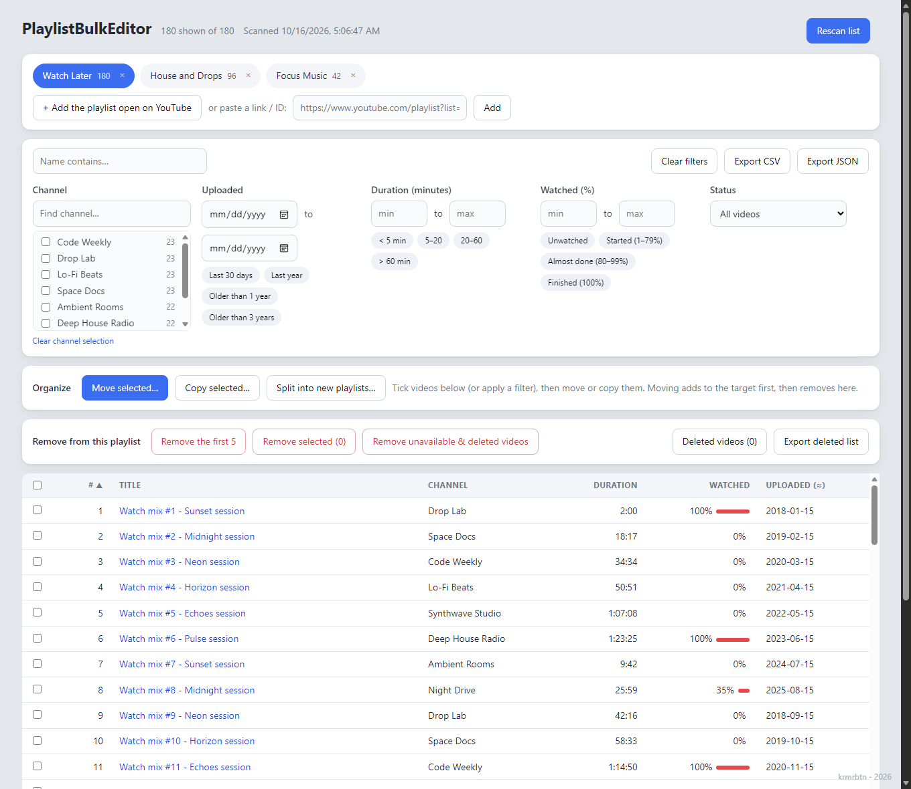

<div align="center">

# PlaylistBulkEditor

**Scan, filter, clean up and reorganize any YouTube playlist, including a huge Watch Later, in bulk.**

A Chrome / Edge extension. No API keys, no server, no account linking: it runs in your own logged-in YouTube session and keeps everything on your machine.

[English](README.md) · [Türkçe](README.tr.md)



<sub>Screenshot uses made-up demo data.</sub>

</div>

---

## Why

YouTube's own UI makes you work one video at a time. If your Watch Later has grown to a thousand-plus videos, you can't see watch progress at a glance, can't filter by channel or length, can't clear everything you've already watched, and can't split it into sensible playlists. The official YouTube API can't help either: it has not exposed Watch Later or watch progress since 2016.

PlaylistBulkEditor works from inside your own YouTube session, so it can see exactly what you see, then act on it in bulk.

## Features

**See everything**
- Scan **any playlist** (including Watch Later, 1,000+ videos) via a link, or the playlist open in your tab. One tab per playlist, each with its own filters, selection and history.
- Per video: title, channel, duration, **watched %**, approximate upload date, unavailable flag.
- Finds **unavailable / private / deleted** entries that YouTube normally hides.

**Filter like a shop**
- Name, channel (multi-select with counts), upload date, duration, watched %, status. Everything combines.
- One-click presets: *Older than 3 years*, *Finished (100%)*, *Under 5 min*, ...
- Tick boxes with *select all*. Applying any filter ticks everything shown.

**Clean up**
- Remove the first 5 (test run), remove selected, or remove all unavailable/deleted videos.
- Red-highlight preview of exactly what will go, an in-page confirmation, a progress bar and a Stop button.
- A persistent **Deleted videos** log, with CSV export, so nothing disappears without a trace.

**Reorganize**
- **Move or copy** selected videos to another playlist, or to a brand-new one.
- **Split wizard**: turn one big list into many new playlists, grouped by *channel*, *upload year*, *duration*, *watch status* or *fixed-size parts*. Rename or untick groups in a preview before anything happens.
- Moving is safe by design: videos are **added to the target first**, and only what was added is removed from the source. If something fails halfway, the video simply stays in both lists.

**Export**
- CSV and JSON export of the current (filtered) view, and of the deleted list.

## Install

The extension is not in the Chrome Web Store, so you load it unpacked:

1. Download the latest zip from [Releases](../../releases) and unzip it, or clone this repo.
2. Open `chrome://extensions` (or `edge://extensions`) and switch on **Developer mode**.
3. Click **Load unpacked** and choose the folder containing `manifest.json`.
4. Open any page on youtube.com, then click the extension icon → **Open dashboard**.

## Usage

1. Open a playlist on YouTube (or use Watch Later), then in the dashboard press **+ Add the playlist open on YouTube**. You can also paste a playlist link or ID.
2. Wait for the scan to finish. The status line shows the count, and compares it with YouTube's header count.
3. Filter, tick, then use **Organize** or **Remove**.

Tip: start with *Remove the first 5* or a 5-video *Copy* to see the behaviour on your own account before doing anything big.

## How it works

The extension's content script runs inside youtube.com and talks to the same internal endpoints the website uses (`youtubei/v1/browse`, `edit_playlist`, `playlist/create`), authenticated by your existing session. All YouTube-specific parsing lives in one file, [`content.js`](content.js). Data is kept in `chrome.storage.local`; nothing is sent anywhere else.

```
content.js        scraper + remove/move/copy queue (runs on youtube.com)
dashboard.html/js full-tab UI: tabs, filters, organize, split wizard
popup.html/js     small launcher + scan status
manifest.json     Manifest V3
```

## Limitations

- **Unofficial.** It relies on YouTube's undocumented internal API, which can change at any time and may break the extension. Automating your own account this way is also a grey area in YouTube's terms; the extension throttles its requests, but use it at your own risk.
- **Upload date is approximate.** The list only exposes relative ages ("4mo ago"), which are converted to a date. Hover a date to see the original text.
- **Editing only works on playlists you own.** Other people's playlists can be scanned and exported, not changed.
- **Mixes** (`RD…` playlists) are endless and not supported.
- Very large jobs are deliberately slow (about one request per second) to avoid rate limits.

## Privacy

Everything stays local in your browser profile. There is no server, no analytics and no remote code. Permissions used: `storage` / `unlimitedStorage` (keep your lists), `tabs` and `scripting` (find and inject into your YouTube tab), and host access to `www.youtube.com`.

## Disclaimer

Not affiliated with or endorsed by YouTube or Google. Removing videos from a playlist is permanent from YouTube's side: export a CSV/JSON first if you may want a backup.

## License

MIT, see [LICENSE](LICENSE).

---

<sub>krmrbtn - 2026</sub>
